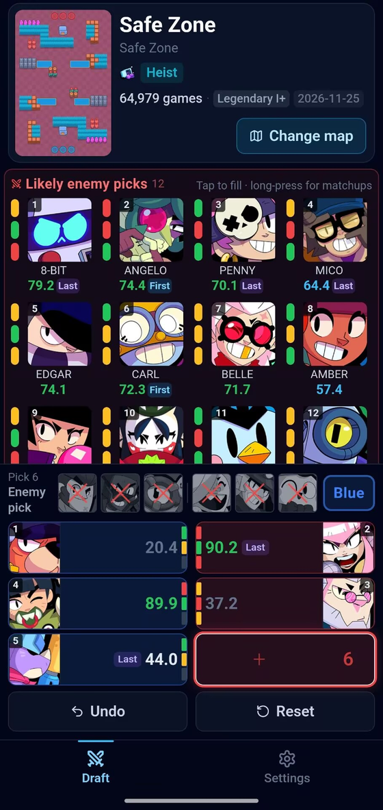
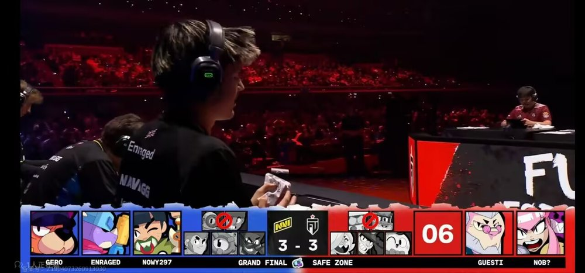
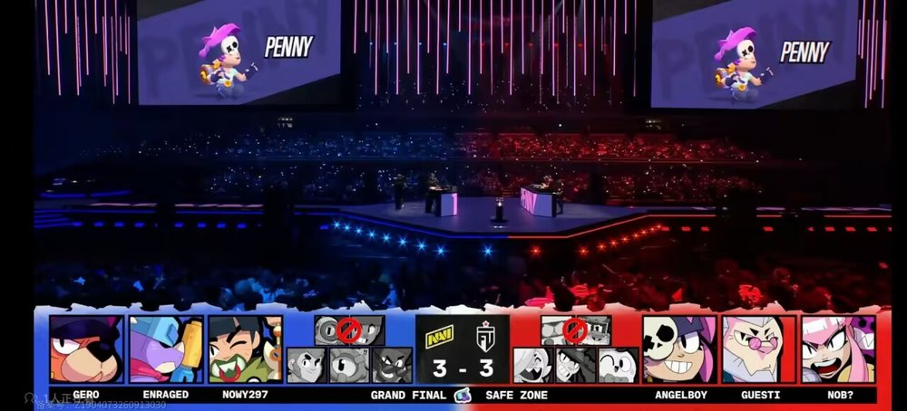

[English](README.md) | [简体中文](README.zh-CN.md) | [繁體中文](README.zh-TW.md)

# ChesStars

**A lightweight, offline-first Brawl Stars Ranked Draft assistant powered by 3v3 regression and symmetric counter-matchup modeling.**

> ### 📱 iOS & Web are coming
> A Web / PWA build — running on iPhone, iPad and desktop — is in development.
> **On iOS today?** Join the [Discord server](https://discord.gg/RXM7E5e4U) and you'll get a ping the day it goes live.

## Why ChesStars?

Ranked gives you roughly twenty seconds per ban and per pick. ChesStars is built for that clock, not for reading stats after the match is over.

### Symmetric Counter-Matchup Engine

Most draft tools rank brawlers by popularity alone. ChesStars looks at **both** sides of the board: every ban and every pick you enter re-weights the recommendation, so it accounts for who you are countering and who is already countering you. Suggestions are ordered by an **Overall Draft Score** — one composite number for "how good is this pick right now", never presented as a win rate.

### Offline-First · Zero Tracking

The whole draft engine runs on your device from a bundled dataset.

- No account, no sign-in, no player tag, no Supercell login.
- No analytics, no ads, no telemetry — your picks never leave the phone.
- Works in airplane mode, on the subway, or in a lobby with one bar of signal.
- It is a standalone companion app and never touches your game client or account.

The single optional network request is the in-app check for a newer release. Skip it and the app is completely offline.

### Fast & Intuitive

One screen, one thumb. Tap a slot to fill it, long-press for details, undo when you change your mind. No onboarding, no setup wizard — you are drafting within a minute.

### Multilingual

Ships in **English**, **简体中文** and **繁體中文**, and follows your system language on first launch.

## Screenshots

<table>
  <tr>
    <td align="center" rowspan="2" width="36%" valign="middle">
       
      Draft board
    </td>
    <td align="center" valign="middle">
       
      The Grand Final, Safe Zone
    </td>
  </tr>
  <tr>
    <td align="center" valign="middle">
       
      Penny called as the sixth pick
    </td>
  </tr>
</table>

> **Validated on a real World Finals draft.** The board on the left recreates the Grand Final draft — Safe Zone, blue side, sixth pick. Penny was on the engine's shortlist for that slot, and Penny was the sixth pick called on stage.

## Download & Installation

### Android

**[⬇ Download the latest APK](https://github.com/Dhik0/ChesStars/releases/latest)**

1. Grab `ChesStars-vX.X.X.apk` from the Releases page.
2. Open the file. Android will ask you to allow installs from this source — that prompt is normal for any app installed outside the Play Store.
3. Install, open, and start drafting. No account needed.

Requires Android 5.1 or newer. The app can check GitHub for newer versions, so you can update without hunting for the download page again.

### iOS / Web — Coming Soon (PWA)

The Web / PWA version is in progress and will run on iPhone, iPad and desktop browsers. Until then, [join the Discord](https://discord.gg/RXM7E5e4U) to be notified at launch.

## Community & Contributing

- **Discord** — [Join the server](https://discord.gg/RXM7E5e4U) for draft feedback, bug reports and translation help.
- **Issues** — [Open an issue](https://github.com/Dhik0/ChesStars/issues) for bugs and feature requests.
- **Translations** — the UI ships as plain JSON locale files. Want your language in the app? Open an issue and claim it; adding one is a small, self-contained change.

## License

ChesStars is released under the **GNU General Public License v3.0** — see [LICENSE](LICENSE). You are free to use, study, share and modify it. If you distribute a modified version, it must stay under the same license with its source available.

Brawl Stars and all related assets and trademarks belong to Supercell. ChesStars is **unofficial fan content**, not affiliated with, endorsed by, or sponsored by Supercell, and is used under the [Supercell Fan Content Policy](https://www.supercell.com/fan-content-policy). The GPL covers this project's own source code only, not Supercell's assets.
