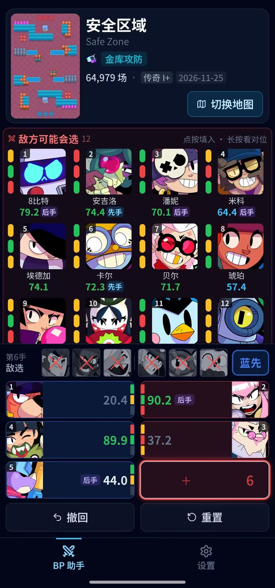
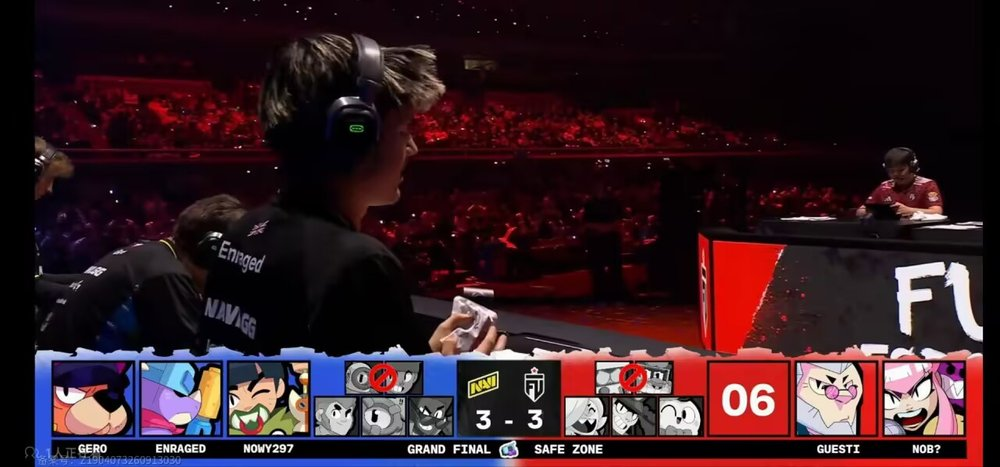

[English](README.md) | [简体中文](README.zh-CN.md) | [繁體中文](README.zh-TW.md)

# ChesStars

**一款轻量、离线优先的荒野乱斗排位 BP 助手，基于 3v3 回归与对称克制建模。**

> ### 🌐 网页版已上线
> ChesStars 现在可以直接在浏览器里用：**iPhone、iPad、Android 和 PC** 都能打开，免安装、免注册。
>
> | 🌐 **网页版 / iOS / PC** | ⬇ **Android** |
> | :---: | :---: |
> | **[chesstars.pages.dev](https://chesstars.pages.dev)** | **[下载最新版 APK](https://github.com/Dhik0/ChesStars/releases/latest)** |
> | 浏览器直接打开 · 可添加到主屏幕 | GitHub Releases · Android 5.1+ |
>
> **iPhone / iPad**：用 Safari 打开链接 → 分享 → **添加到主屏幕**。**电脑**：在 Chrome / Edge 地址栏点安装图标。添加后从桌面图标启动即为全屏，断网也能继续 BP。

## 为什么选 ChesStars

排位 BP 每个 Ban 位、每个 Pick 位只有二十秒左右。ChesStars 就是为这二十秒做的，不是赛后再翻数据的工具。

### 对称克制引擎

多数 BP 工具只按英雄热度排序。ChesStars 看的是**双方**：你每填入一个 Ban 或 Pick，推荐都会重新计算，既算你能克制谁，也算谁已经在克制你。候选英雄按**综合推荐得分**排序——一个「现在这个位置该不该拿」的单一结论，而不是胜率。

### 离线优先 · 零追踪

整套推荐逻辑都在你的手机本地运行，数据随安装包一起下发。

- 不需要账号、不需要登录、不需要填玩家 Tag、不需要绑定 Supercell 账号。
- 没有统计埋点、没有广告、没有遥测，你选了什么不会离开这台手机。
- 它是独立的辅助工具，不接触你的游戏客户端和游戏账号。

唯一可选的联网动作是检查是否有新版本；不检查，App 就完全离线。

### 快、顺手

一个界面，一只手。点格子填入，长按看详情，选错了直接撤回。没有新手引导，没有初始化流程，一分钟内就能开始 BP。

### 多语言

内置 **English**、**简体中文**、**繁體中文**，首次启动会跟随系统语言。

## 界面预览

<table>
  <tr>
    <td align="center" rowspan="2" width="36%" valign="middle">
       
      BP 面板
    </td>
    <td align="center" valign="middle">
       
      世锦赛决赛现场，安全区域
    </td>
  </tr>
  <tr>
    <td align="center" valign="middle">
       
      第 6 手现场公布潘妮
    </td>
  </tr>
</table>

> **用真实世界赛对局验证过。** 左侧面板复刻的是世锦赛决赛这一局的 BP——安全区域，蓝方，第 6 手。引擎给这一手的候选里就有潘妮，而现场第 6 手叫出的也正是潘妮。

## 下载与安装

### Android

**[⬇ 下载最新版 APK](https://github.com/Dhik0/ChesStars/releases/latest)**

1. 在 Releases 页面下载 `ChesStars-vX.X.X.apk`。
2. 直接打开安装包。系统会提示「允许来自此来源的应用」——非应用商店安装都会出现这个提示，属于正常现象。
3. 安装后打开即可开始 BP，无需注册或登录。

支持 Android 5.1 及以上。App 内可以检查新版本，不必每次都回来找下载页。

### 网页版 / iOS / PC（PWA）

**在线使用：[chesstars.pages.dev](https://chesstars.pages.dev)** —— 不用下载，不用注册。

- **iPhone / iPad** —— 用 Safari 打开链接，点「分享」→「添加到主屏幕」，之后从桌面图标启动就是全屏应用。
- **Android** —— 用 Chrome 打开，菜单里选「安装应用」/「添加到主屏幕」；想要原生安装包就用上面的 APK。
- **电脑** —— Chrome、Edge 地址栏右侧会出现安装图标；Safari、Firefox 直接当普通网页用即可。

第一次打开会把用得到的资源存到本地，之后断网也能正常 BP、照常看推荐；联网后在设置页点一下就能拉取最新数据。

## 社区与反馈

- **Discord** —— [加入服务器](https://discord.gg/RXM7E5e4U)：排位 BP 建议、Bug 反馈、翻译协作。
- **QQ 交流群** —— `1056621315`（[点击一键加群](https://qm.qq.com/q/yJm7ocJ5fO)）：版本更新通知与问题排查。
- **Issues** —— [提交 Issue](https://github.com/Dhik0/ChesStars/issues)：Bug 与功能建议。
- **翻译** —— 界面文案是独立的 JSON 语言文件。想让 App 支持你的语言？开个 Issue 认领即可，改动范围很小。

## 开源协议

本项目以 **GNU GPLv3** 协议开源，全文见 [LICENSE](LICENSE)。你可以自由使用、研究、分享和修改；如果分发修改后的版本，需要继续使用同一协议并公开对应源码。

荒野乱斗及相关素材、商标归 Supercell 所有。ChesStars 属于**非官方粉丝内容**，与 Supercell 无隶属关系，也未获其认可或赞助，依 [Supercell 粉丝内容政策](https://www.supercell.com/fan-content-policy) 使用。GPL 仅覆盖本项目自身的源代码，不覆盖 Supercell 的素材。
