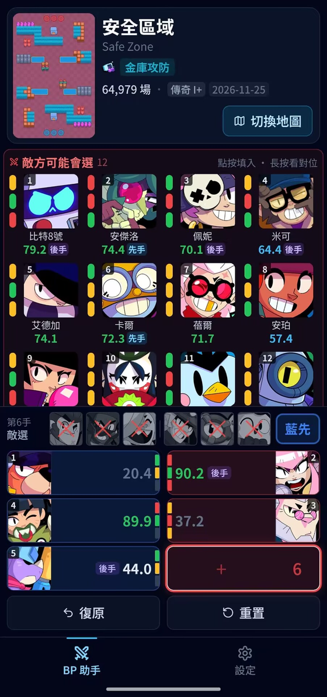
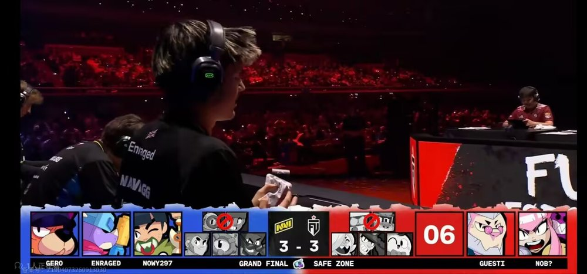

[English](README.md) | [简体中文](README.zh-CN.md) | [繁體中文](README.zh-TW.md)

# ChesStars

**輕量、離線優先的《荒野亂鬥》排位 BP 助手，以 3v3 迴歸與對稱剋制模型為核心。**

> ### 🌐 網頁版已上線
> ChesStars 現在可以直接在瀏覽器裡使用：**iPhone、iPad、Android 與 PC** 都能開啟，免安裝、免註冊。
>
> | 🌐 **網頁版 / iOS / PC** | ⬇ **Android** |
> | :---: | :---: |
> | **[chesstars.pages.dev](https://chesstars.pages.dev)** | **[下載最新版 APK](https://github.com/Dhik0/ChesStars/releases/latest)** |
> | 瀏覽器直接開啟 · 可加入主畫面 | GitHub Releases · Android 5.1+ |
>
> **iPhone / iPad**：用 Safari 開啟連結 → 分享 → **加入主畫面**。**電腦**：在 Chrome / Edge 網址列點安裝圖示。加入後從桌面圖示啟動即為全螢幕，離線也能繼續 BP。

## 為什麼選 ChesStars

排位 BP 每個禁用位、每個選擇位只有大約二十秒。ChesStars 就是為這二十秒而做，不是賽後才翻資料的工具。

### 對稱剋制引擎

多數 BP 工具只按英雄熱度排序。ChesStars 看的是**雙方**：你每填入一個禁用或選擇，推薦就會重新計算，既算你能剋制誰，也算誰已經在剋制你。候選英雄依**綜合推薦得分**排序——一個「現在這個位置該不該拿」的單一結論，而不是勝率。

### 離線優先 · 零追蹤

整套推薦邏輯都在你的手機本機執行，資料隨安裝檔一併提供。

- 不需要帳號、不需要登入、不需要填玩家 Tag、不需要綁定 Supercell 帳號。
- 沒有統計追蹤、沒有廣告、沒有遙測，你選了什麼不會離開這支手機。
- 它是獨立的輔助工具，不會接觸你的遊戲客戶端與遊戲帳號。

唯一可選的連網動作是檢查是否有新版本；不檢查，App 就完全離線。

### 快、順手

一個介面，一隻手。點格子填入，長按看詳情，選錯了直接復原。沒有新手引導，沒有初始化流程，一分鐘內就能開始 BP。

### 多語言

內建 **English**、**简体中文**、**繁體中文**，首次啟動會跟隨系統語言。

## 介面預覽

<table>
  <tr>
    <td align="center" rowspan="2" width="36%" valign="middle">
       
      BP 面板
    </td>
    <td align="center" valign="middle">
       
      世界大賽決賽現場，安全區域
    </td>
  </tr>
  <tr>
    <td align="center" valign="middle">
       
      第 6 手現場公布佩妮
    </td>
  </tr>
</table>

> **以真實世界賽對局驗證過。** 左側面板重現的是世界大賽決賽這一局的 BP——安全區域，藍方，第 6 手。引擎給這一手的候選裡就有佩妮，而現場第 6 手喊出的也正是佩妮。

## 下載與安裝

### Android

**[⬇ 下載最新版 APK](https://github.com/Dhik0/ChesStars/releases/latest)**

1. 在 Releases 頁面下載 `ChesStars-vX.X.X.apk`。
2. 直接開啟安裝檔。系統會提示「允許來自此來源的應用程式」——非應用程式商店安裝都會出現這個提示，屬正常現象。
3. 安裝後開啟即可開始 BP，無需註冊或登入。

支援 Android 5.1 以上。App 內可以檢查新版本，不必每次都回來找下載頁。

### 網頁版 / iOS / PC（PWA）

**線上使用：[chesstars.pages.dev](https://chesstars.pages.dev)** —— 免下載、免註冊。

- **iPhone / iPad** —— 用 Safari 開啟連結，點「分享」→「加入主畫面」，之後從桌面圖示啟動就是全螢幕應用程式。
- **Android** —— 用 Chrome 開啟，選單中選「安裝應用程式」/「加到主畫面」；想用原生安裝檔就下載上面的 APK。
- **電腦** —— Chrome、Edge 網址列右側會出現安裝圖示；Safari、Firefox 直接當一般網頁使用即可。

第一次開啟會把需要的資源存到本機，之後離線也能正常 BP、照常查看推薦；連網後在設定頁點一下就能取得最新資料。

## 社群與回饋

- **Discord** —— [加入伺服器](https://discord.gg/RXM7E5e4U)：排位 BP 建議、問題回報、翻譯協作。
- **Issues** —— [提交 Issue](https://github.com/Dhik0/ChesStars/issues)：程式錯誤與功能建議。
- **翻譯** —— 介面文案是獨立的 JSON 語言檔。想讓 App 支援你的語言？開個 Issue 認領即可，改動範圍很小。

## 授權

本專案以 **GNU GPLv3** 授權釋出，全文見 [LICENSE](LICENSE)。你可以自由使用、研究、分享與修改；若散佈修改後的版本，必須沿用同一授權並公開對應原始碼。

《荒野亂鬥》及相關素材、商標皆屬 Supercell 所有。ChesStars 為**非官方粉絲內容**，與 Supercell 並無隸屬關係，亦未獲其認可或贊助，依 [Supercell 粉絲內容政策](https://www.supercell.com/fan-content-policy) 使用。GPL 僅涵蓋本專案自身的原始碼，不涵蓋 Supercell 的素材。
